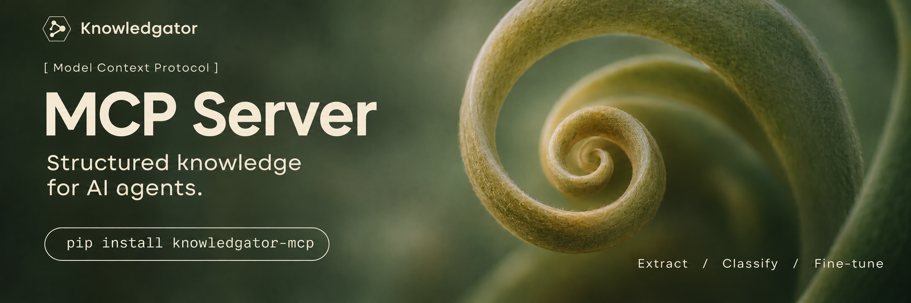

<h1>Knowledgator MCP Server</h1>

<div align="center">

<a href="https://platform.knowledgator.com/">
  
</a>

<p>
  <a href="https://docs.knowledgator.com/docs/mcp/"></a>
  <a href="https://platform.knowledgator.com/"></a>
  <a href="https://pypi.org/project/knowledgator-mcp/"></a>
  <a href="https://modelcontextprotocol.io/"></a>
  <a href="https://pypi.org/project/knowledgator-mcp/"></a>
  <a href="https://pypi.org/project/knowledgator-mcp/"></a>
  <a href="https://github.com/Knowledgator/knowledgator-mcp/blob/main/LICENSE"></a>
</p>

</div>

The Knowledgator MCP Server exposes the [Knowledgator](https://platform.knowledgator.com/) platform to AI agents through the [Model Context Protocol](https://modelcontextprotocol.io/). Agents such as Claude, Cursor or any other MCP client can run zero-shot classification, entity and relation extraction and structured extraction, and can manage datasets, generate synthetic data and fine-tune models, all through natural-language requests.

It is built on the [Knowledgator Python SDK](https://github.com/Knowledgator/knowledgator-sdk.py) and supports the `stdio`, `sse` and `streamable-http` transports.

### Key Advantages
* **Efficiency**: Based on non-generative technologies, our solutions are *100×* faster and more cost-efficient.
* **Precision**: Designed and tailored to information extraction needs, our models demonstrate better precision than LLMs.
* **Interpretability**: Every processing result comes in structured form with a confidence score, offering a reliable indicator of precision to guide your trust in automation.
* **Customisability**: Our models can be fine-tuned with a few examples to achieve results on par with supervised models.
* **Modularity**: Naturally providing structured outputs, our APIs can be chained to solve complex end-to-end information extraction tasks.

### What Agents Can Do
* **Inference**: Classify text with `Comprehend-it`, extract entities and relations with `Extract-it`, fill JSON templates with `Instruct-it`, and call fine-tuned Open Models.
* **Datasets**: Plan and generate synthetic datasets, upload your own data, browse and download datasets, and get HTML analytics reports.
* **Fine-tuning**: Pick a base model, start and stop training jobs, track their status, and get HTML training-metrics reports.

## Documentation

Guides and API reference for the Knowledgator MCP Server are available [here](https://docs.knowledgator.com/docs/mcp/).

## Quick Installation

> **Python Version Policy**: Supports Python 3.11+.

Run it without installing, using [uv](https://docs.astral.sh/uv/):

```bash
uvx knowledgator-mcp --transport stdio
```

Or install via pip:

```bash
pip install knowledgator-mcp
```

You can also install from source by cloning the repo:

```bash
git clone git@github.com:Knowledgator/knowledgator-mcp.git
cd knowledgator-mcp
pip install -e .
```

## Quick Start

### API Key Setup

Before using the server, obtain a Knowledgator API key from [platform.knowledgator.com](https://platform.knowledgator.com/account/api-keys).

Set your API key as an environment variable:

```bash
$ export KG_API_KEY="your_api_key_here"
```

You can write it to zsh in the following way:

```bash
# Set Knowledgator API Key (using zsh for example)
$ echo 'export KG_API_KEY=[your_key_here]' >> ~/.zshenv

# Reload the environment (or open a new terminal)
$ source ~/.zshenv
```

The server reads `KG_MCP_API_KEY` first and falls back to `KG_API_KEY`. You can also put it in a `.env` file in the working directory.

### Claude Desktop

Add the server to `claude_desktop_config.json`:

```json
{
  "mcpServers": {
    "knowledgator": {
      "command": "uvx",
      "args": ["knowledgator-mcp", "--transport", "stdio"],
      "env": {
        "KG_API_KEY": "your_api_key_here"
      }
    }
  }
}
```

### Claude Code

```bash
claude mcp add knowledgator --env KG_API_KEY=your_api_key_here -- uvx knowledgator-mcp --transport stdio
```

### Cursor and Other MCP Clients

Any client that launches local MCP servers can use the same command: `uvx knowledgator-mcp --transport stdio`, with `KG_API_KEY` set in its environment. For clients that connect over HTTP, see [Running as an HTTP Server](#running-as-an-http-server).

### Example Prompts

Once connected, ask your agent things like:

```text
Classify these product reviews as positive, negative or neutral.
Extract all people, organizations and locations from this article.
Generate a NER dataset of 500 medical notes with drug and dosage entities.
Fine-tune a model on that dataset and show me the training metrics.
```

## Table of Contents

- [Available Tools](#available-tools)
- [Running as an HTTP Server](#running-as-an-http-server)
- [Authentication Modes](#authentication-modes)
- [Configuration](#configuration)
- [Command-Line Options](#command-line-options)
- [Docker](#docker)
- [Model Types: LoRA Adapters vs. Open Models](#model-types-lora-adapters-vs-open-models)
- [Development](#development)

## Available Tools

### Inference

- `comprehend_inference`: Zero-shot and few-shot text classification with `Comprehend-it` or a fine-tuned adapter.
- `extract_inference`: Entity and relation extraction with `Extract-it` or a fine-tuned adapter.
- `instruct_inference`: Structured extraction into a JSON template with `Instruct-it`.
- `open_model_inference`: Prediction with a standalone full Open Model (`POST /inference/{model_id}/`).

### Datasets

- `generate_dataset_plan`: Drafts a dataset creation plan from a description. Always the first step of dataset generation.
- `start_dataset_generation`: Starts generation after the user confirms the plan.
- `list_datasets`: Lists datasets with optional filtering.
- `get_dataset_details`: Gets metadata for a dataset.
- `get_dataset_analytics_report`: Builds an HTML report with dataset analytics charts.
- `list_data`: Lists raw data with optional filtering.
- `download_dataset`: Downloads a dataset in memory.
- `upload_dataset`: Validates and uploads data as a new dataset.

### Fine-tuning

- `list_models`: Lists base models and public catalog adapters.
- `get_model_details`: Gets model details, including which inference service it uses.
- `get_inference_details`: Gets the inference input schema for a model.
- `start_training_job`: Creates and starts a fine-tuning job.
- `get_training_status`: Gets the status of a training job.
- `list_trainings`: Lists training jobs with optional filtering.
- `stop_training_job`: Stops a running training job.
- `get_training_metrics_report`: Builds an HTML report with training metrics charts.

### Resources

- `config://app`: Server name, debug mode, auth type and base URL.

## Running as an HTTP Server

By default the server runs over Streamable HTTP on `127.0.0.1:8000`:

```bash
knowledgator-mcp
# equivalent to:
knowledgator-mcp --transport streamable-http --host 127.0.0.1 --port 8000
```

The MCP endpoint is `http://127.0.0.1:8000/mcp` (or `/sse` with `--transport sse`). To connect Claude Code to it:

```bash
claude mcp add --transport http knowledgator http://127.0.0.1:8000/mcp
```

## Authentication Modes

Select the mode with `KG_MCP_AUTH_TYPE`.

| Mode | `KG_MCP_AUTH_TYPE` | Where the API key comes from | Use for |
| :--- | :--- | :--- | :--- |
| **API key** (default) | `api_key` | `KG_MCP_API_KEY` or `KG_API_KEY` on the server | Local use and single-user deployments |
| **API proxy** | `api_proxy` | Each HTTP request, in the `KnowledgatorAPI-Key` or `Authorization: Bearer <key>` header | Shared, multi-user deployments |

In `api_proxy` mode the server stores no key. Each request's key is scoped to that request only, so users of a shared server never see each other's keys. Requests without a key are rejected with `401`.

```bash
KG_MCP_AUTH_TYPE=api_proxy knowledgator-mcp --host 0.0.0.0 --port 8000 \
  --allowed-hosts "mcp.example.com"

# Client side
claude mcp add --transport http knowledgator https://mcp.example.com/mcp \
  --header "KnowledgatorAPI-Key: your_api_key_here"
```

## Configuration

All settings are read from environment variables with the `KG_MCP_` prefix, or from a `.env` file.

| Variable | Default | Description |
| :--- | :--- | :--- |
| `KG_MCP_API_KEY` | – | Knowledgator API key (falls back to `KG_API_KEY`) |
| `KG_MCP_AUTH_TYPE` | `api_key` | `api_key` or `api_proxy` |
| `KG_MCP_BASE_URL` | `https://api.platform.knowledgator.com` | Knowledgator API base URL |
| `KG_MCP_REQUEST_TIMEOUT_MS` | `60000` | Request timeout for API calls, in milliseconds |
| `KG_MCP_SERVER_NAME` | `KnowledgatorMCP` | Server name reported to MCP clients |
| `KG_MCP_DEBUG` | `false` | Enable debug mode |
| `KG_MCP_PLATFORM_FRONTEND_URL` | `https://platform.knowledgator.com` | Platform URL used in links returned to the agent |
| `KG_MCP_ENABLE_DNS_REBINDING_PROTECTION` | `true` | Validate `Host` and `Origin` headers |
| `KG_MCP_ALLOWED_HOSTS` | `localhost`, `127.0.0.1`, `[::1]` (any port) | Allowed `Host` values; comma-separated or a JSON list |
| `KG_MCP_ALLOWED_ORIGINS` | – | Allowed `Origin` values; comma-separated or a JSON list |

## Command-Line Options

| Option | Default | Description |
| :--- | :--- | :--- |
| `--transport` | `streamable-http` | `stdio`, `sse` or `streamable-http` |
| `--host` | `127.0.0.1` | Host interface for HTTP transports |
| `--port` | `8000` | Port for HTTP transports |
| `--allowed-hosts` | – | Comma-separated allowed `Host` values (e.g. `mcp.example.com,localhost:*`) |
| `--allowed-origins` | – | Comma-separated allowed `Origin` values (e.g. `https://example.ai`) |
| `--disable-dns-protection` | off | Disable DNS rebinding protection (not recommended for production) |

> ⚠️ **Important**: When exposing the server on a public host, add that host to `--allowed-hosts` (or `KG_MCP_ALLOWED_HOSTS`). Otherwise DNS rebinding protection rejects the requests. Keep the protection on in production.

## Docker

```bash
docker build --ssh default=$SSH_AUTH_SOCK -t knowledgator-mcp:latest .

docker run -p 8000:8000 -e KG_API_KEY=your_api_key_here knowledgator-mcp:latest \
  --transport streamable-http --host 0.0.0.0 --port 8000 --allowed-hosts "localhost:*,127.0.0.1:*"
```

The image starts the server over Streamable HTTP on port `8000`.

## Model Types: LoRA Adapters vs. Open Models

Knowledgator supports two distinct types of fine-tuned and custom models, and the agent picks the right tool based on `get_model_details`:

| Model Type | Platform Representation | Tool to Use |
| :--- | :--- | :--- |
| **LoRA Adapters** | `type="adapter"` (attached to a base service like `comprehend-it` or `extract-it`) | `comprehend_inference` / `extract_inference` / `instruct_inference` with `adapter_id` |
| **Open Models** | `type="model"` (standalone full model, e.g. fine-tuned `gliclass-x-base`, `gliner-base`) | `open_model_inference` with `model_id` |

> ⚠️ **Important**: An Open Model ID passed as `adapter_id` is rejected by the base service with HTTP 503 (`server.resource_unavailable`). Use `open_model_inference` for Open Models.

## Development

```bash
git clone git@github.com:Knowledgator/knowledgator-mcp.git
cd knowledgator-mcp
poetry install

# Run locally
poetry run knowledgator-mcp --transport stdio

# Inspect the tools interactively
npx @modelcontextprotocol/inspector poetry run knowledgator-mcp --transport stdio

# Tests and linting
poetry run pytest
poetry run ruff check .
```

## Contributing
Feel free to contribute and open issues or PRs.

1. Fork → feature branch → PR.
2. For docs tweaks (like this README) – patch away, no generator sync needed.
3. For runtime changes – supply tests; we’ll migrate logic upstream.

## License

This project is licensed under the [Apache License 2.0](LICENSE).
